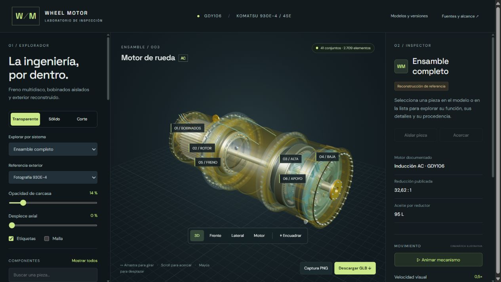

# Wheel Motor Inspector · revisión 03

Visor web de un modelo 3D representativo de wheel motor GDY106 para el proyecto **NTT DATA Hack The Challenge**. Incluye 41 conjuntos seleccionables y 2.709 elementos geométricos, con transparencia, corte, despiece axial, movimiento ilustrativo y exportación GLB.



## Trabajo realizado y metodología

Se construyó y refinó un ensamble 3D por componentes a partir de las imágenes, los videos y la investigación previa del proyecto. Las formas exteriores se contrastaron con fotografías y fotogramas; la arquitectura interna se apoyó en documentación Komatsu y la patente GE. El modelado se implementó mediante geometría procedimental en JavaScript y Three.js, con medidas y cantidades aproximadas.

El proceso incluyó inventario de referencias, revisión visual de videos, contraste de variantes GDY106/GDY108, tres iteraciones del ensamble, comprobaciones geométricas y cinemáticas, revisión de los controles en navegador, exportación GLB, publicación del visor y entrega en GitHub.

La [memoria del trabajo: qué se hizo, cómo, fuentes y herramientas](docs/proceso-fuentes-herramientas.md) documenta cada etapa y relaciona la evidencia con los cambios del modelo.

| Herramienta | Uso en este trabajo |
|---|---|
| OpenAI Codex | Asistencia en investigación, programación, contraste de referencias y revisión del resultado |
| HTML, CSS y JavaScript | Interfaz del inspector y generación de geometría |
| Three.js r180 / WebGL 2 | Ensamble, materiales transparentes, selección, corte y renderizado 3D |
| GLTFExporter de Three.js | Exportación del modelo a GLB |
| Python, FFmpeg, imageio-ffmpeg y Pillow | Extracción de fotogramas y hojas de revisión de videos |
| Node.js | Servidor local, comprobaciones y exportación reproducible |
| Navegador integrado de Codex | Revisión visual y comprobación de controles y descargas |
| Sites | Publicación del visor web con acceso privado |
| Git, GitHub y PowerShell | Versionado, entrega del código, paquetes y verificación SHA-256 |

Las fuentes principales son los [materiales aportados y el registro de revisión](docs/revision-03.md), los [folletos oficiales Komatsu](docs/proceso-fuentes-herramientas.md#fuentes-documentales), la [patente GE US7455616B2](https://patents.google.com/patent/US7455616B2/en) y las investigaciones previas conservadas en `dist/assets/`. La memoria distingue lo observado, lo documentado y lo reconstruido de forma ilustrativa.

## Abrir el visor

La [web ya publicada](https://wheel-motor-inspector-3d.glossy-snow-8166.chatgpt.site) conserva su acceso privado. Para ejecutarlo localmente se necesita Node.js 20 o posterior y un navegador con WebGL 2:

```sh
git clone https://github.com/joseroavargas409/wheel-motor-inspector.git
cd wheel-motor-inspector
npm start
```

Abre **http://127.0.0.1:8846/**. El repositorio es privado: la clonación requiere acceso a la cuenta o al repositorio. No hay dependencias que instalar; Three.js se distribuye localmente. Sirve la carpeta mediante HTTP para que funcionen los módulos del navegador.

Arrastra para girar, usa la rueda para acercar y Mayús + arrastre para desplazar. La lista permite mostrar, seleccionar y aislar piezas. Puedes elegir sistema, referencia exterior, vista sólida/transparente, corte X/Y/Z, despiece y animación. Algunas piezas permiten abrir el fotograma que fundamenta su forma.

## Modelo y descargas

El [paquete de revisión 03](https://github.com/joseroavargas409/wheel-motor-inspector/releases/tag/v0.3.0) incluye el **GLB de 57 MB**, una copia del proyecto y sus comprobantes SHA-256.

El botón **Descargar GLB** del visor guarda geometría, pose y visibilidad actuales. El corte y la animación temporal no se exportan. Para regenerar el GLB del ensamble transparente en reposo:

```sh
npm run export:glb
```

Se crea `models/wheel-motor-gdy106-revision-03.glb`. Llantas, neumáticos y tambor CIMETP están ocultos por defecto.

## Qué contiene esta revisión

- Freno de estacionamiento multidisco seco: discos móviles, separadores fijos, alojamiento, pistón, sellos y resortes.
- Carcasa de perfil suave, testero y campana abiertos, bridas, pernos, tapones y orejas.
- Estator, rotor de jaula, eje prolongado, aislación de ranuras, amarres de cabezas y puentes de fase.
- Dos planetarios con manguito intermedio, apoyos, cubo y freno de servicio.
- Referencia exterior CIMETP opcional y comparación documental de GDY106, GDY106-B/C, GDY108-C y GDY108D.

La revisión visual del seminario de mantenimiento utilizó **117 fotogramas**. No constituye una transcripción íntegra del audio. Las imágenes, los clips, la patente y las fichas Komatsu se distinguen en el [registro de fuentes y decisiones](docs/revision-03.md); las fotos y fotogramas técnicos utilizados están en `dist/assets/`. Los videos originales completos no son necesarios para ejecutar el visor.

## Alcance

Es una **reconstrucción visual con medidas y cantidades aproximadas**, no CAD OEM autenticado ni un procedimiento de mantenimiento. La relación ilustrativa de 32,6087:1 usa dentados 18/27/72 y 23/52/127. La comparación GDY108 es documental; no hay cotas disponibles para convertir este ensamble a cada variante. La discrepancia entre fuentes oficiales del 980E-4 aparece explícita en el visor.

No simula lubricación, presión hidráulica, campos electromagnéticos, contacto elástico, cargas ni tolerancias. La capacidad publicada de aceite no valida un volumen o nivel del modelo.

## Comprobaciones

```sh
npm test
```

Se verifican vértices finitos, fases de montaje de los satélites, cinemática con corona fija, relación total y algunas separaciones nominales de ejes, apoyos, frenos y captador. El resultado está en [geometry-checks.json](dist/assets/geometry-checks.json). No es un análisis exhaustivo de interferencias ni una certificación OEM. El exportador comprueba el encabezado y la estructura glTF 2.0 del GLB.

## Organización

| Ruta | Contenido |
|---|---|
| `dist/index.html`, `style.css`, `app.js` | Interfaz y controles |
| `dist/model.js` | Definiciones y utilidades geométricas |
| `dist/assembly-v2.js` | Base mecánica de la revisión anterior |
| `dist/assembly-v3.js` | Ensamble y refinamientos de revisión 03 |
| `dist/assets/` | Referencias, investigación y registro de revisión |
| `dist/vendor/` | Three.js y utilidades locales |
| `server.mjs` | Servidor local |
| `verify-v2.mjs` | Verificación adaptada al ensamble actual |
| `export-model.mjs` | Exportación del ensamble completo desde Node.js |
| `docs/` | Vista previa y documentación de revisión 03 |

Consulta [THIRD_PARTY_NOTICES.md](THIRD_PARTY_NOTICES.md) para la procedencia de la biblioteca y del material de referencia.
